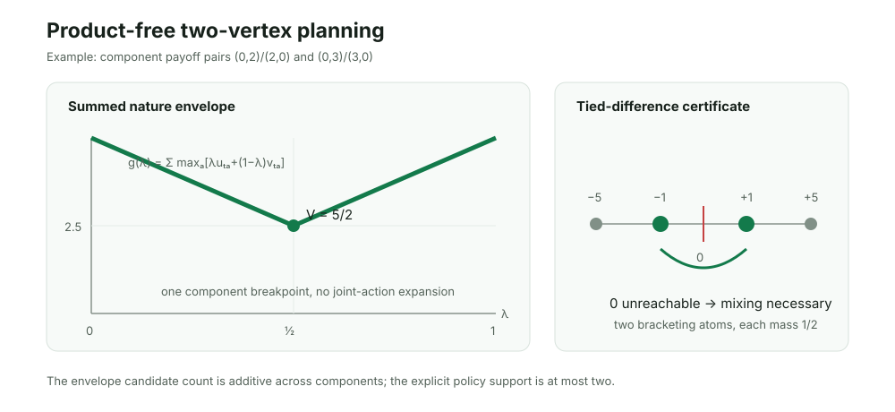

# Two-vertex additive envelope law

## Smallest supported claim

For a finite robust game with exactly two coupled ambiguity vertices and an
additive payoff across components, THEORICA can compute an exact optimal joint
policy without constructing the Cartesian joint-action space.

For component action payoff pairs `(u_ta, v_ta)`, define

`g(lambda) = sum_t max_a [lambda u_ta + (1-lambda) v_ta]`.

The robust value is `min_{lambda in [0,1]} g(lambda)`. It is sufficient to test
the two endpoints and every pairwise line intersection within each component,
at most

`2 + sum_t binom(|A_t|, 2)`

candidates. The returned executable joint policy has at most two atoms,
independent of the number of components or the product action count.

At an interior minimizing `lambda*`, let `B_t` be the component actions tied on
the upper envelope and let `Delta_t = {u_ta-v_ta : a in B_t}`. A deterministic
optimal policy exists **iff**

`0 in Delta_1 + ... + Delta_T`.

If zero is absent, randomization is strictly necessary. Any reachable negative
and positive extreme differences give two tied joint responses whose exact
zero-balancing mixture is optimal.

## Proof

A joint action contributes the sum of its component payoff pairs, so the set of
joint outcome pairs is the Minkowski sum of the component outcome sets. Finite
minimax duality gives

`V = min_lambda max_joint [lambda U + (1-lambda)V]
   = min_lambda sum_t max_a [lambda u_ta + (1-lambda)v_ta]`.

Each component term is a convex piecewise-linear upper envelope. Its slope can
change only where two of that component's action lines intersect; hence a global
minimum of the sum occurs at an endpoint or one of the stated intersections.

At an interior minimizer, the active joint responses are exactly the Cartesian
products of the tied component actions. Every such response has weighted payoff
equal to the dual value. It is deterministic-maximin exactly when its two
scenario payoffs are equal, equivalently when the sum of its component
differences is zero. If no zero sum is reachable, convex optimality guarantees
reachable differences on both sides of zero. Mixing the two corresponding joint
responses with masses `d+/(d+-d-)` and `-d-/(d+-d-)` equalizes the scenarios at
the dual value. This proves both optimality and the two-atom bound. At a boundary
minimum, a one-sided active response is pure-optimal.

## Frozen evidence

- Protocol committed before generating the prospective holdout.
- 6,561/6,561 exhaustive opened games matched an independently expanded exact
  two-column solver.
- Zero exact-value mismatches and zero strict-randomization mismatches.
- 1,324 exhaustive cases required randomization; 5,237 exposed a pure optimum.
- 32/32 frozen mixed-dimension holdouts from seed `20261027` matched exactly.
- Holdouts split 16 strict / 16 pure; maximum expanded baseline size was 512
  joint actions, maximum envelope candidate count was nine, and support never
  exceeded two.
- A separate Fraction-only checker reproduced the 6,561-case digest, all 32
  holdouts, every policy payoff, the strictness decisions, and the primary file
  digest without importing the production function.
- Scaling witness: 20 components with five actions each replace
  `5^20 = 95,367,431,640,625` joint actions with three realized envelope
  candidates (the theorem bound is 202) and return a two-atom strict optimum.
- Missing additivity, malformed pairs, and tied-difference state-cap overflow
  fail closed rather than invoke an approximate route.

| Gate | Result |
|---|---:|
| Exhaustive exact comparisons | 6,561 / 6,561 |
| Exhaustive value mismatches | 0 |
| Exhaustive strictness mismatches | 0 |
| Prospective exact comparisons | 32 / 32 |
| Prospective value/strictness mismatches | 0 / 0 |
| Maximum returned support | 2 |
| Scaling compression | `5^20` actions to 3 candidates |

## Executable consequence

`synthesize_two_vertex_additive_plan` now returns exact rational nature weight,
one- or two-atom joint policy, minimax value, a pure-optimal witness when one
exists, and an explicit `strict_randomization_necessary` decision. The planner's
candidate sweep grows quadratically within components rather than exponentially
across them. The tied-difference search is separately capped and abstains when
an exact strictness certificate would exceed its configured state budget.

## Adversarial boundary and limitations

- The theorem requires exactly two coupled ambiguity vertices. Three vertices
  produce a two-dimensional nature simplex and are not covered by the scalar
  envelope law.
- Additivity is a trusted proof obligation. An undeclared cross-component payoff
  term can invalidate the decomposition, so absence of the certificate is a
  hard rejection.
- The candidate sweep is product-free, but the exact zero-reachability set of
  tied differences can grow rapidly; the implementation fails closed above its
  cap rather than claiming strictness approximately.
- Exact rational inputs are required. No perturbation theorem for approximate
  ties or floating-point ambiguity is claimed.
- The result is a static finite-game law, not a sequential or adaptive policy
  theorem.

## Novelty audit

Finite minimax and its linear-programming equivalence are classical. Shapley
and Snow's basic-solution theory already supplies sparse optimal strategies for
finite matrix games, and a two-column game classically admits a maximizing
strategy supported on at most two rows. Minkowski sums and piecewise-linear
upper envelopes are also established tools.

The targeted search did not locate a source stating this exact combination:
component-local breakpoint enumeration, the tied-difference Minkowski criterion
for whether randomization is necessary, and a product-free executable two-atom
construction for additive two-scenario robust planning. That absence is not
proof of priority. The defensible contribution is therefore the sharp
compositional certificate, exact prospective evidence, and integrated THEORICA
planner—not the underlying minimax or support theorem.

Closest foundations:

- L. S. Shapley and R. N. Snow, *Basic Solutions of Discrete Games*, in
  Contributions to the Theory of Games I, 1950/1952.
- G. B. Dantzig, *A Proof of the Equivalence of the Programming Problem and the
  Game Problem*, 1951.
- H. W. Kuhn and A. W. Tucker (eds.), *Contributions to the Theory of Games I*.
